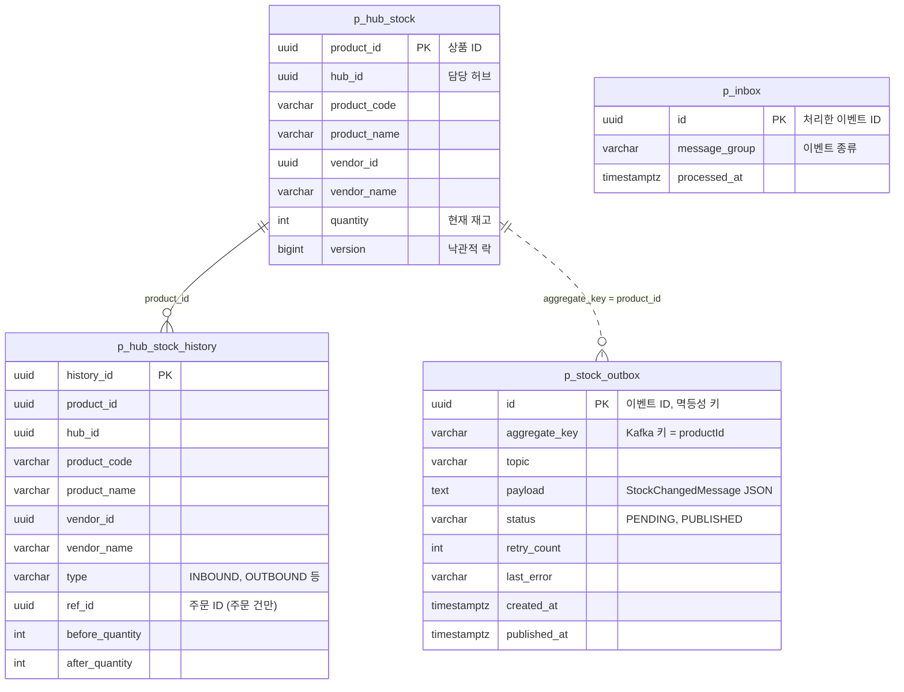
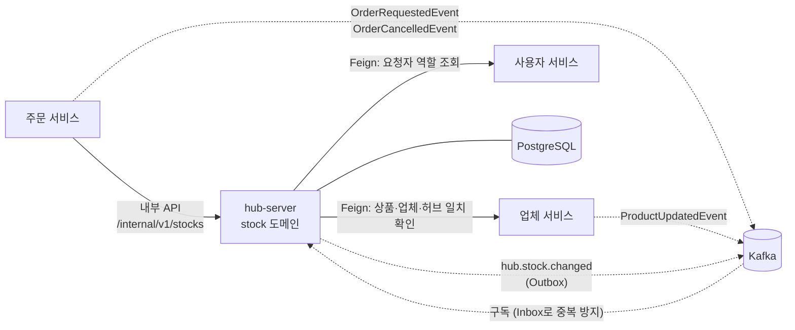
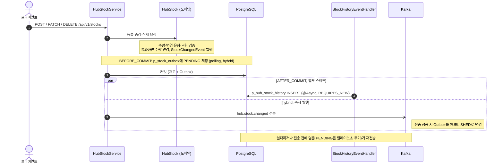
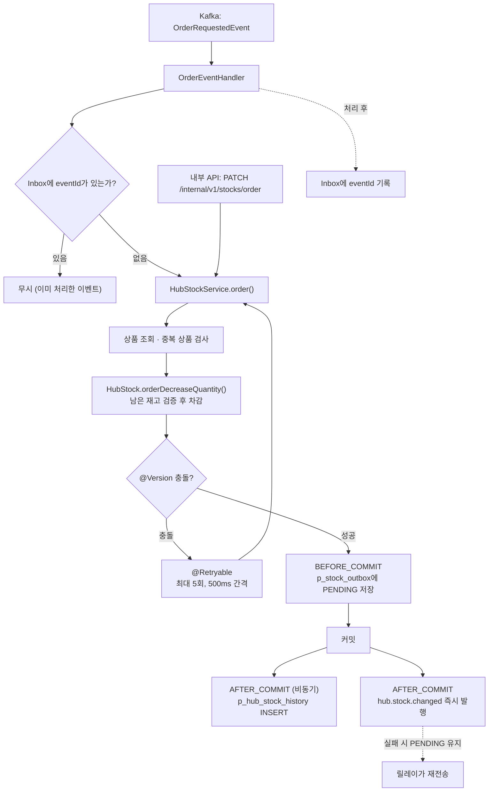
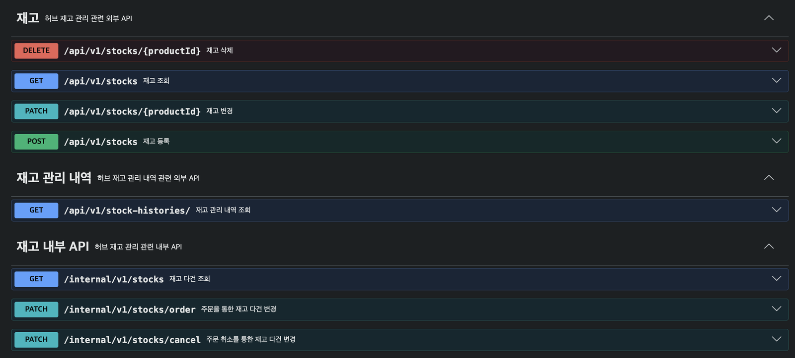

# hub-server

FollowMe MSA의 허브 서버입니다. `hub`(허브 관리)와 `stock`(허브 재고 관리) 두 도메인으로 나뉩니다.

| 도메인     | 내용                                                         | 담당  |
|---------|------------------------------------------------------------|-----|
| `hub`   | 허브 관리                                                      | 김준언 |
| `stock` | 허브 재고 등록·조회·변경·삭제, 재고 변경 이력, 주문에 따른 재고 차감·복구, 재고 변경 이벤트 발행 | 정승현 |

이 문서는 **stock 도메인**만 설명합니다. 담당 범위는 커밋 기준으로 정리했습니다.

## 기술 스택

Java 21 · Spring Boot 3.5.13 · Spring Cloud 2025.0.1 · Spring Data JPA · PostgreSQL 15 · Kafka · OpenFeign +
Resilience4j · springdoc(Swagger UI) · Testcontainers

## stock 도메인 구성

```
src/main/java/followMe/hub_server/stock
├── presentation     HubStockController, HubStockHistoryController, InternalHubStockController
├── application
│   ├── service      HubStockService, QueryHubStockService, QueryHubStockHistoryService
│   └── event        OrderEventHandler, ProductEventHandler, StockHistoryEventHandler
├── domain           HubStock, HubStockHistory, StockErrorCode, StockChangedEvent
└── infrastructure
    ├── client       Vendor/User FeignClient + FallbackFactory
    └── messaging    DirectStockEventPublisher, outbox/ (StockOutbox, Recorder, Relay, ImmediatePublisher)
```

### 설계에서 신경 쓴 부분

- **재고 규칙은 `HubStock` 엔티티 안에 둡니다.** 수량 증감, 변경 유형(입고·출고·파손·반품·단종·주문 취소) 검증, 남은 재고 검증, 권한 검증(MASTER, 담당 HUB), 재고가 남은 상품의
  삭제 금지를 엔티티 메서드가 처리하고, 서비스는 조회와 호출 순서만 맡습니다.
- **재고 변경 이력은 별도 트랜잭션으로 기록합니다.** 재고가 바뀌면 도메인 이벤트(`StockChangedEvent`, `StockOrderEvent`)가 발행되고,
  `StockHistoryEventHandler`가 `AFTER_COMMIT` + `@Async` + `REQUIRES_NEW`로 `p_hub_stock_history`에 저장합니다.
- **주문에 따른 재고 차감은 낙관적 락 + 재시도로 처리합니다.** `HubStock`에 `@Version`을 두고, `HubStockService.order()`에 `@Retryable`(낙관적 락 충돌 시
  최대 5회, 500ms 간격)을 적용했습니다.
- **주문·상품 이벤트는 Inbox로 중복 처리를 막습니다.** `OrderRequestedEvent`, `OrderCancelledEvent`, `ProductUpdatedEvent`를 Kafka로 받으며,
  처리한 `eventId`를 Inbox에 기록해 같은 이벤트를 다시 처리하지 않습니다.
- **재고 변경 이벤트는 Outbox 패턴으로 발행합니다.** 재고 변경과 같은 트랜잭션에서 `p_stock_outbox`에 저장하고, 커밋 직후 즉시 발행하며, 실패분은 폴링 릴레이가 재시도합니다. 토픽은
  `hub.stock.changed`, 메시지 키는 `productId`입니다. 직접 발행 → 폴링 Outbox → 하이브리드 3단계를 같은 장애 시나리오로 비교한
  결과는 [docs/outbox-verification.md](docs/outbox-verification.md)에 있습니다.
- **외부 서비스 호출은 Feign + Resilience4j를 사용합니다.** vendor-server, user-server 호출에 재시도(최대 3회)와 서킷브레이커를 적용했고 FallbackFactory를
  두었습니다.

### 발행 방식 설정 (`event.publish.mode`)

재고 변경 이벤트를 어떻게 발행할지는 `event.publish.mode` 값으로 고릅니다. **값을 지정하지 않으면 재고 변경 이벤트는 발행되지 않습니다.**

| 값         | 동작                                           |
|-----------|----------------------------------------------|
| `direct`  | 커밋 후(`AFTER_COMMIT`) Kafka로 바로 발행. Outbox 없음 |
| `polling` | Outbox에 저장, 1초 간격 릴레이가 발행                    |
| `hybrid`  | Outbox에 저장, 커밋 직후 즉시 발행하고 실패분은 릴레이가 재시도      |

릴레이 관련 옵션: `outbox.relay.interval-ms`(기본 1000), `outbox.relay.min-age-ms`(기본 0), `outbox.relay.send-timeout-ms`(기본 5000)

## 테이블 구조

stock 도메인이 쓰는 테이블입니다. 테이블 사이에 FK는 없고, 아래 선은 값으로 연결되는 논리적 관계입니다.



- `p_hub_stock`, `p_hub_stock_history`는 공통 감사 컬럼(`created_at/by`, `updated_at/by`, `deleted_at/by`)을 가집니다. 삭제는
  `deleted_at`을 채우는 soft delete입니다.
- `p_hub_stock_history`는 재고가 바뀔 때마다 상품·업체 정보와 변경 전후 수량을 그대로 복사해 쌓는 기록 테이블입니다. 이후 상품 정보가 바뀌어도 과거 이력은 바뀌지 않습니다.
- `p_stock_outbox`는 `event.publish.mode`가 `polling` 또는 `hybrid`일 때 사용합니다.
- `p_inbox`는 공통 라이브러리(`common-lib`)의 엔티티입니다. Kafka로 받은 주문·상품 이벤트의 중복 처리를 막는 데 씁니다.

## 다른 서비스와의 연결

stock 도메인이 코드에서 직접 주고받는 대상입니다.



- 서비스 간 호출(Feign)에는 재시도와 서킷브레이커를 적용했습니다.
- 서비스 등록(Eureka), 설정 서버, 추적(Zipkin)은 팀 공통 구성을 사용합니다.

## 처리 흐름

### 재고 등록·변경·삭제



### 주문에 따른 재고 차감·복구

주문 서비스가 Kafka 이벤트(`OrderRequestedEvent`)로 요청하거나 내부 API(`PATCH /internal/v1/stocks/order`)를 직접 호출하면 같은 서비스 로직을 탑니다.



주문 취소에 따른 복구(`OrderCancelledEvent`, `/internal/v1/stocks/cancel`)는 같은 흐름이며 수량을 더합니다.

## API

Swagger UI에서 확인할 수 있습니다. 서버를 실행한 뒤 <http://localhost:8087/swagger-ui.html> 로 접속합니다.



- 외부 API: `/api/v1/stocks`, `/api/v1/stock-histories`
- 내부 API(서비스 간 호출): `/internal/v1/stocks` (다건 조회, 주문 차감 `/order`, 주문 취소 복구 `/cancel`)
- 요청 헤더: `X-User-Id`, `X-Role` 필수 / `X-Hub-Id`, `X-Vendor-Id`, `X-User-Name` 선택

## 실행

사전 준비

- JDK 21, Docker
- 공통 라이브러리(`com.followMe:common-lib`)는 GitHub Packages에서 받습니다. `~/.gradle/gradle.properties`에 `gpr.user`, `gpr.key`(
  read:packages 권한 토큰)를 설정합니다.

```bash
# 인프라 (PostgreSQL, Kafka 3대 등)
docker compose up -d

# 서버 (포트 8087)
./gradlew bootRun
```

로컬 기본 접속 정보는 `src/main/resources/application.yaml`과 `docker-compose.yml`에 있습니다.

## 테스트

Testcontainers(PostgreSQL 15, Kafka `confluentinc/cp-kafka:7.6.1`)를 사용하므로 Docker가 실행 중이어야 합니다.

```bash
# Stage 0: 직접 발행 — 브로커 장애 중 커밋하면 이벤트가 유실되는지 확인
./gradlew cleanTest test --tests '*Stage0DirectLossTest'

# Stage 1: 폴링 Outbox
./gradlew cleanTest test --tests '*Stage1PollingOutboxTest'

# Stage 2: 하이브리드 Outbox (즉시 발행 + 폴링 재시도)
./gradlew cleanTest test --tests '*Stage2HybridOutboxTest'
```

시나리오, 측정 방법, 결과는 [docs/outbox-verification.md](docs/outbox-verification.md)를 참고하세요.

## 관련 PR (stock 도메인)

| PR                                                    | 내용                                                              |
|-------------------------------------------------------|-----------------------------------------------------------------|
| [#16](https://github.com/8ollowMe/hub-server/pull/16) | 재고·재고 이력 도메인, 예외/에러코드, 이력 비동기 저장, 서비스 로직                        |
| [#22](https://github.com/8ollowMe/hub-server/pull/22) | 외부/내부 API, Kafka 이벤트 핸들러(주문·상품), Feign client                   |
| [#24](https://github.com/8ollowMe/hub-server/pull/24) | Feign 호출 헤더 수정                                                  |
| [#29](https://github.com/8ollowMe/hub-server/pull/29) | Swagger API 명세, 기본 정렬, fallbackFactory, Zipkin 설정, 주문 재고 차감 재시도 |
| [#32](https://github.com/8ollowMe/hub-server/pull/32) | Outbox 패턴 + Stage 0/1/2 재현 테스트                                  |
